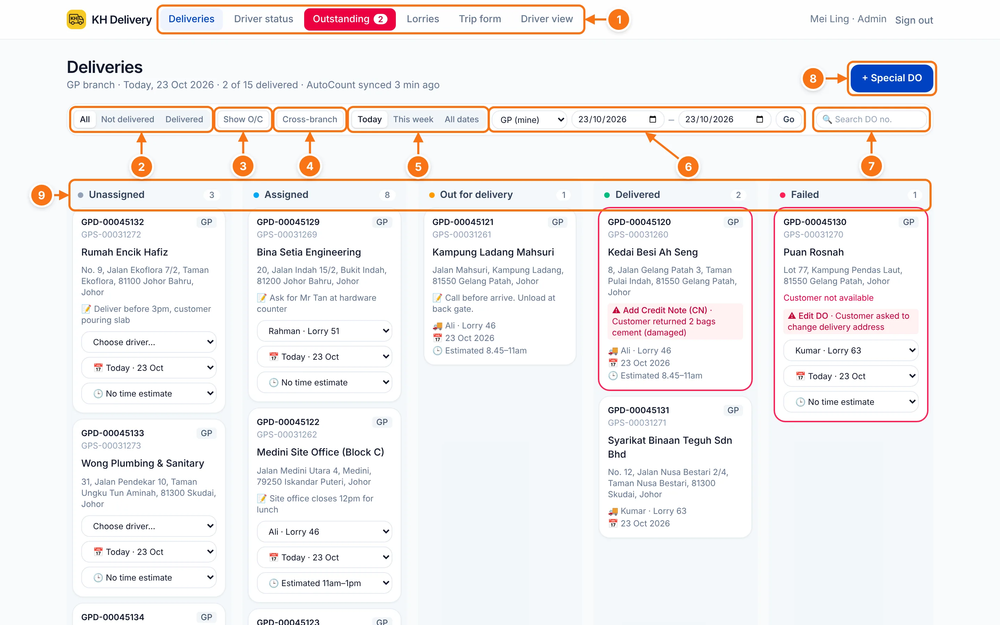
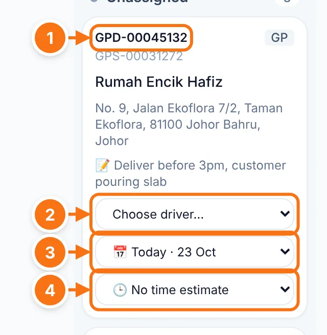
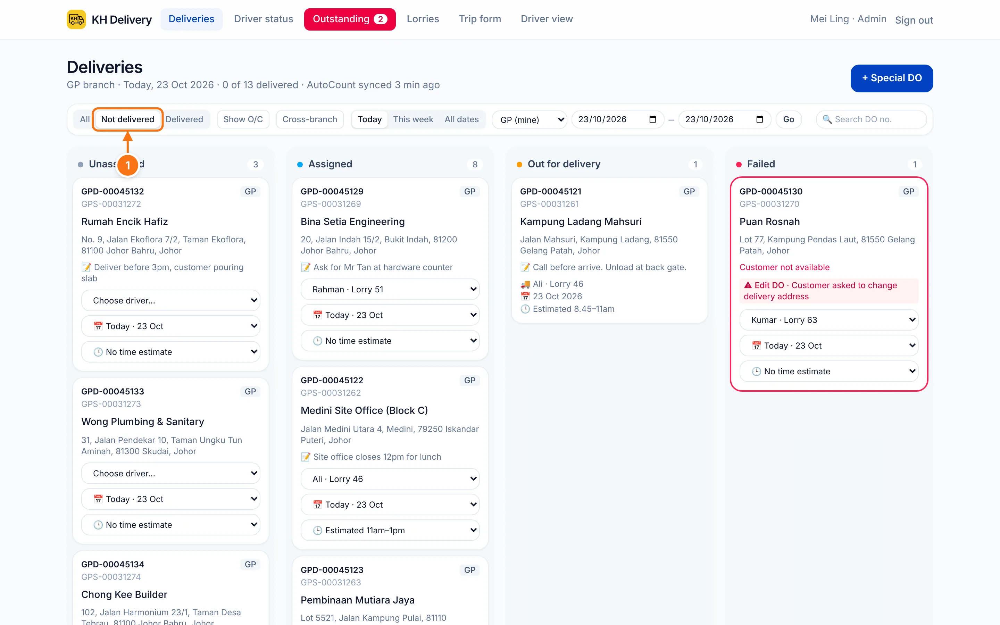
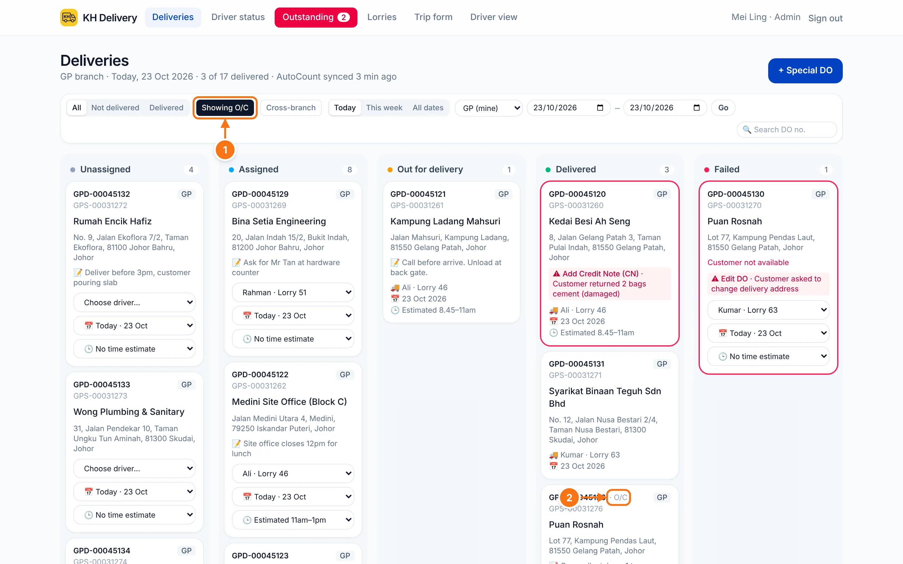
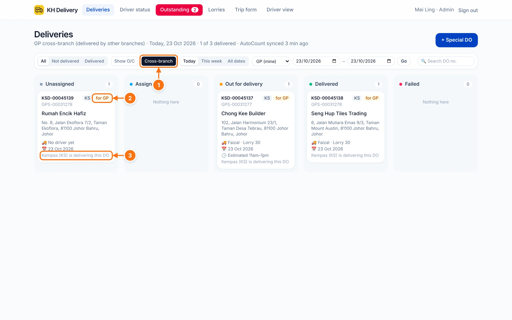
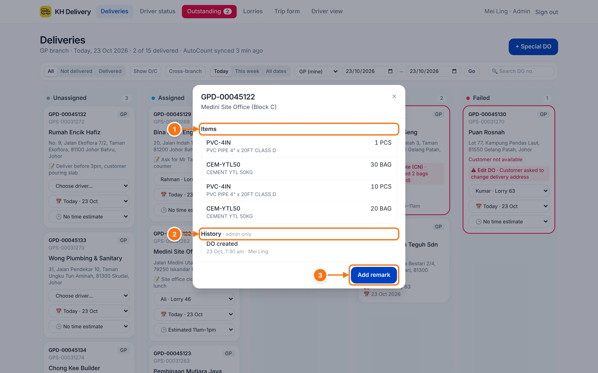
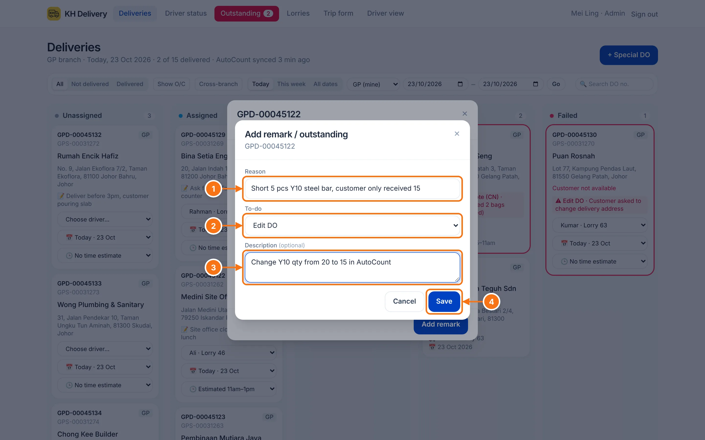
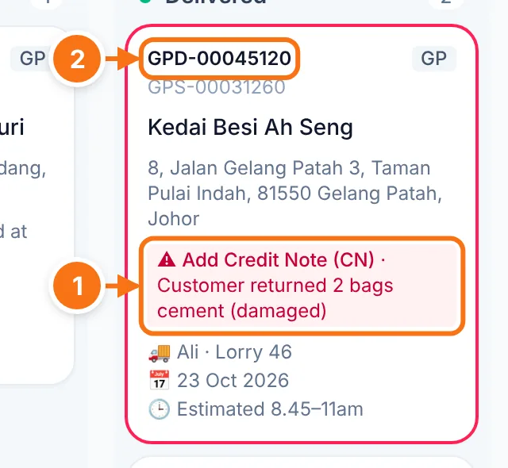
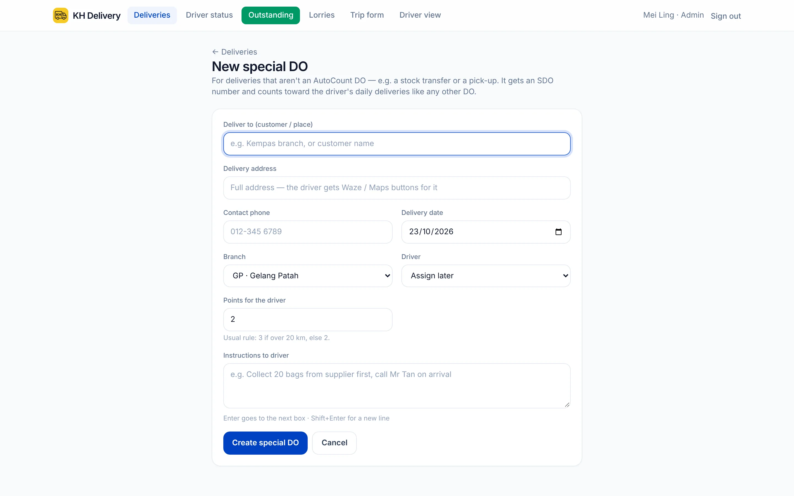

# Deliveries

The main page for the office. Every DO for your branch, grouped by where it is now. It opens on **today** and updates by itself when a driver changes something.

## The page at a glance

- 1 **Menu.** The **Outstanding** tab is red with a number while remarks are still open, and green when everything is cleared.
- 2 **All / Not delivered / Delivered.** Show every DO, only the ones still to go, or only finished ones.
- 3 **Show O/C.** Own-collection DOs (customer collects at the store) are hidden by default. Tap to show them.
- 4 **Cross-branch.** DOs your branch sold that another branch is delivering. See [Cross-branch](#cross-branch-dos-another-branch-delivers).
- 5 **Today / This week / All dates.** Quick date ranges.
- 6 **Branch and date range.** Pick any dates, then tap **Go**. Admins can also switch branch here.
- 7 **Search DO no.** Type part of a DO number to find it across all dates.
- 8 **+ Special DO.** Add a delivery that isn't an AutoCount DO. See [Special DOs](#special-dos).
- 9 **Status columns.** Unassigned → Assigned → Out for delivery → Delivered, plus Failed. The number is how many DOs are in each.

The line under the title shows the branch, the dates, how many are delivered, and when AutoCount last synced.

## Assign a driver, date and time

Each DO card that hasn't left yet can be planned right on the card.

- 1 **DO number.** Tap it to see the items and add a remark. See [Remarks](#add-a-remark-outstanding).
- 2 **Choose driver.** Pick the driver (their lorry number shows next to the name). The DO moves to **Assigned** and appears on that driver's phone. Pick **O/C (customer collects)** if there's no delivery.
- 3 **Delivery date.** Today, tomorrow, the day after, or **Pick a date…** for any other day.
- 4 **Estimated time.** Optional time window (for example 11am–1pm). The driver sees it on their phone.

Changes save straight away. There's no Save button.

::: info
- Only the branch that **delivers** the DO can plan it. Other branches can see it but not change it.
- Once the driver taps **Start delivery**, the card no longer shows the pickers.
- A **Failed** DO can be given a driver and date again. It goes back to **Assigned**.
- A date in red with **· late** means the DO is past its date and still not delivered.
:::

To put several DOs in a trip together, or change their order, use [Driver status](./driver-status).

## Not delivered only

- 1 **Not delivered** hides the Delivered column, so you only see what still needs doing. Combine it with **This week** to catch anything left behind.

## O/C (own collection)

DOs where the customer collects at the store are marked **O/C**. They're hidden unless you turn them on.

- 1 **Showing O/C** (dark) means O/C DOs are included. Tap again to hide them.
- 2 O/C DOs show **· O/C** next to the DO number.

The app marks a DO as O/C when its remarks or address say "O/C" or "own collect". To change it, pick a driver (it becomes a delivery) or pick **O/C (customer collects)** in the driver box.

## Cross-branch: DOs another branch delivers

Sometimes we sell to a customer, but another branch delivers. For example, we ask Kempas to deliver our SO.

- 1 **Cross-branch** (dark when on) shows only the DOs your branch sold that another branch is delivering.
- 2 **for GP** means the DO was sold by GP. The grey tag before it (**KS**) is the branch delivering it.
- 3 You can follow the status, driver and date, but you **can't** assign or change anything. Only the delivering branch can.

## Add a remark (Outstanding)

Use this when a DO needs to be fixed in AutoCount later (credit note, edit DO, delivery return) but you don't have time now. The remark stays visible until someone clears it.

**Step 1.** Tap the **DO number** on any card.

- 1 **Items** on this DO, with quantities.
- 2 **History** of who changed the DO and when (admins only).
- 3 Tap **Add remark**.

**Step 2.** Fill in the remark.

- 1 **Reason.** What happened, for example "Customer returned 2 bags".
- 2 **To-do.** What needs doing in AutoCount: **Add Credit Note (CN)**, **Edit DO**, **Add Delivery Return (DR)**, or **Others** (then type what).
- 3 **Description** (optional). Extra details, like the new quantity.
- 4 **Save.**

**Step 3.** The DO card now has a red border and shows the remark, and the **Outstanding** tab turns red.

- 1 The open remark: what to do · why.
- 2 Tap the DO number again to see the remark and **Clear** it once it's fixed.

All open remarks are listed on the [Outstanding](./outstanding) page.

## Special DOs

For deliveries that aren't an AutoCount DO, such as a stock transfer to another branch or a pick-up from a supplier. They get an **SDO-** number and count toward the driver's deliveries like any other DO.

1. Tap **+ Special DO** at the top of Deliveries.
2. Fill in **Deliver to**, **Delivery address** (the driver gets Waze / Maps buttons for it), **Contact phone** and **Delivery date**.
3. Pick the **Branch** and a **Driver**, or leave it as **Assign later**.
4. Set **Points for the driver** (usually 3 if over 20 km, otherwise 2).
5. Add **Instructions to driver** if needed, for example "Collect 20 bags from supplier first".
6. Tap **Create special DO**.

You can **Edit** a special DO from its card until the driver starts it. Only the person who created it, or an admin, can edit it.
