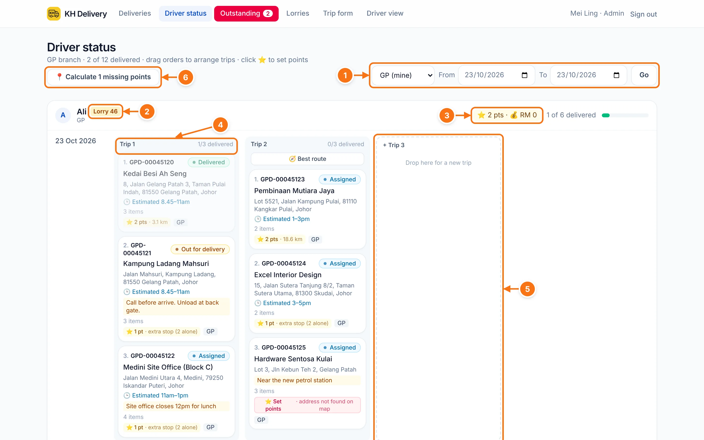
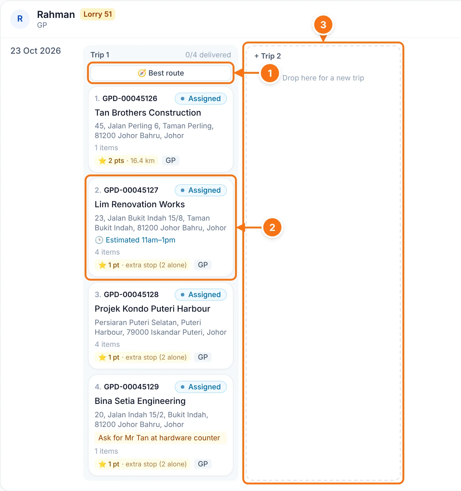
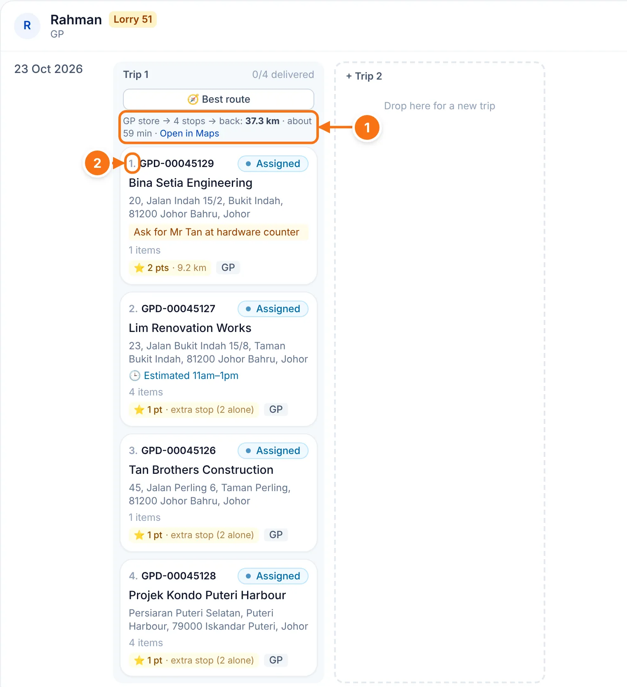
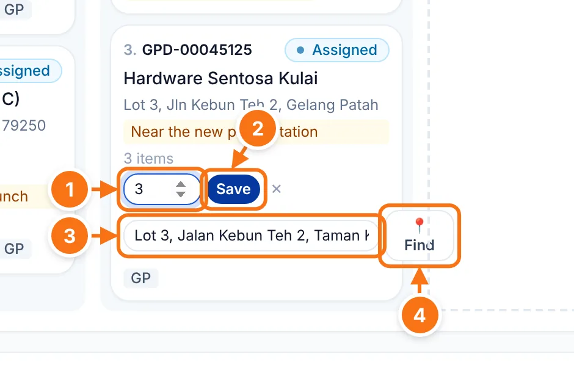
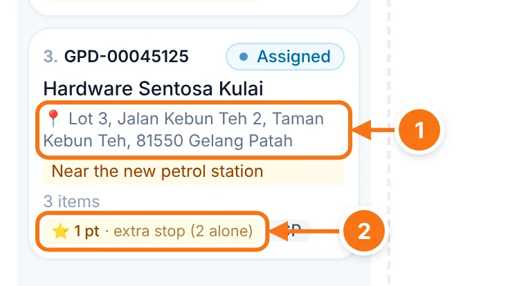

# Driver status

Each driver's DOs for the day, split into trips. This is where you arrange which DOs go together, in which order, and on which day.

## The page at a glance

- 1 **Branch and dates.** Opens on today for your branch. Pick a **From** and **To** date to plan several days (up to 31), then tap **Go**.
- 2 The **lorry** this driver is on. Set it on [Lorries](./lorries).
- 3 **Points and commission** the driver has earned in these dates, from DOs already delivered. See [Points & commission](./points).
- 4 A **trip**, with how many of its DOs are delivered. DOs are numbered in the order the driver will go.
- 5 **+ Trip.** An empty space at the end of each day. Drag a DO here to start a new trip.
- 6 **Calculate missing points.** Shows when some DOs have no points yet. Tap it to work them out from the distance.

Each day of the date range has its own row, so you can also drag a DO to another day.

## Arrange trips

- 1 **🧭 Best route.** Works out the shortest order from the store, through every stop and back. It shows once a trip has 2 or more DOs that haven't left yet.
- 2 **Drag a DO** to change its order in the trip, move it to another trip, another driver or another day.
- 3 **Drop it here** to put it in a new trip.

How to move a DO:

1. Click and hold the DO card.
2. Drag it to where you want it. A blue line shows where it will land.
3. Let go. It saves straight away, and the driver's phone updates.

::: warning Can't drag it?
DOs that are **Out for delivery** or **Delivered** stay where they are. DOs another branch delivers can't be moved either.
:::

## Best route

Tap **🧭 Best route** on a trip.

- 1 The route: store → number of stops → back, total **km** and about how long it takes. **Open in Maps** shows the whole route in Google Maps (up to 9 stops).
- 2 The DOs are **re-numbered in the new order**. The driver sees them in this order on their phone.

If an address can't be found on the map, that DO is put last and listed in red. Fix it with [Fix an address or points](#fix-an-address-or-points) below and run Best route again.

## Fix an address or points

Every DO has a ⭐ chip with its points. A **red "Set points"** chip means the map couldn't find the address, so there are no points yet. Click the chip to fix it.

- 1 **Points.** Type the points yourself if you know them.
- 2 **Save** the points.
- 3 **Address to find on the map.** Type an address Google can find. Adding the taman or town usually helps.
- 4 **📍 Find.** Looks up the new address and works out the distance and points.

- 1 A **📍** means the DO is using the address you typed. The driver's **Waze** and **Maps** buttons go to this address. The AutoCount address isn't changed.
- 2 The points are filled in.

In the editor you can also tap **use it again** to go back to the AutoCount address, or **Use distance rule instead** to undo points you typed in.
