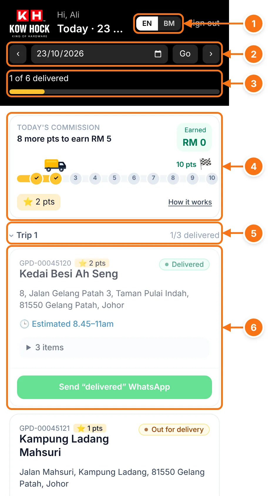
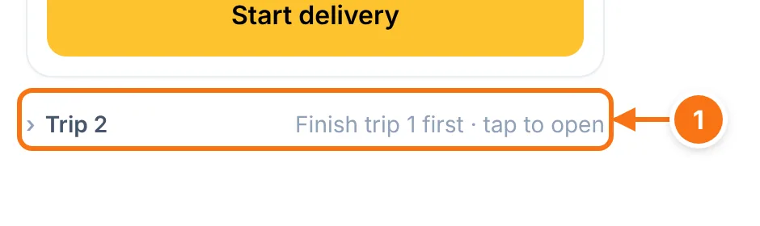
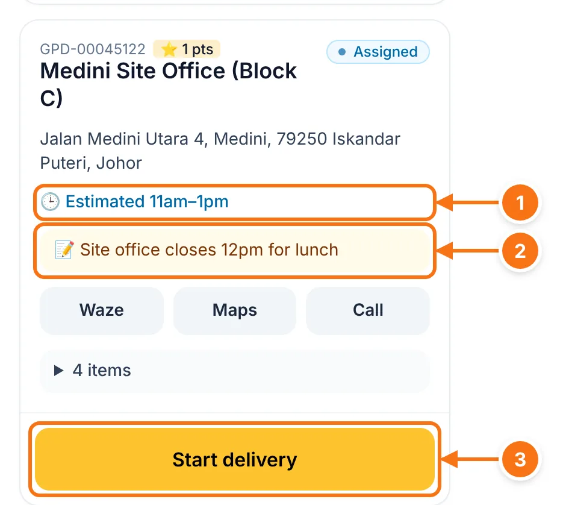
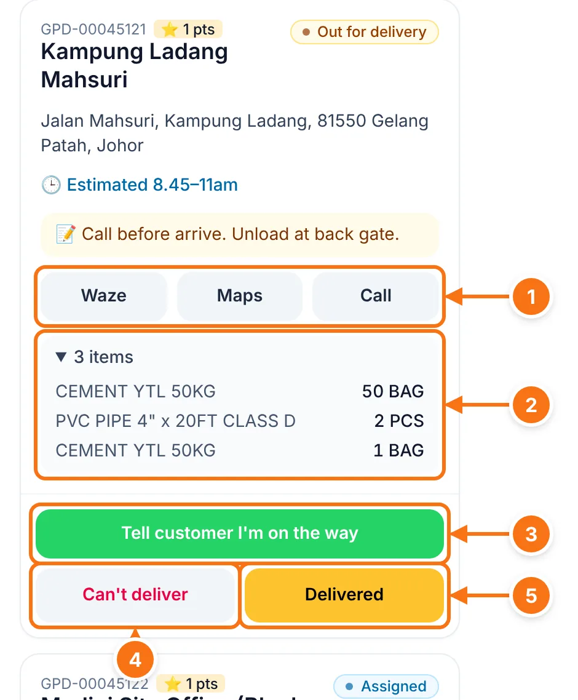
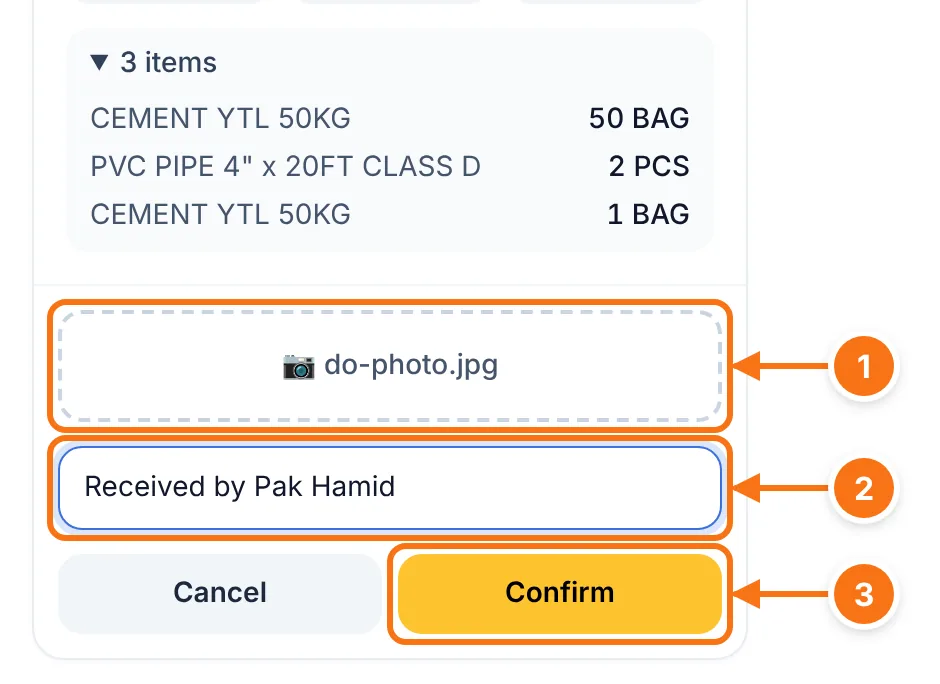
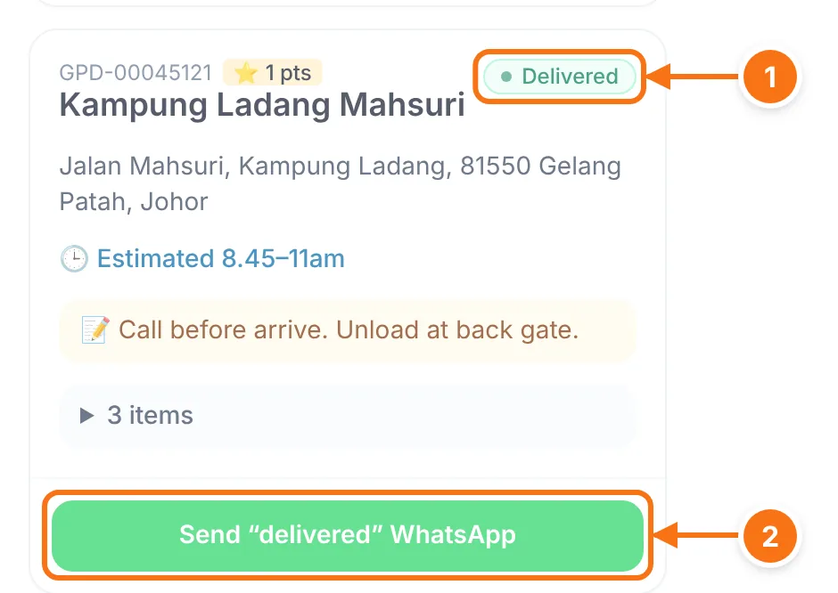
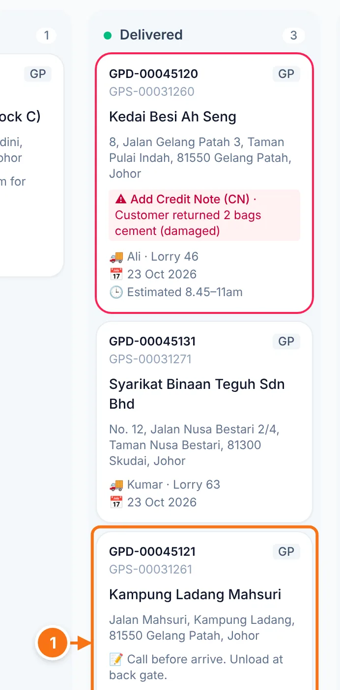
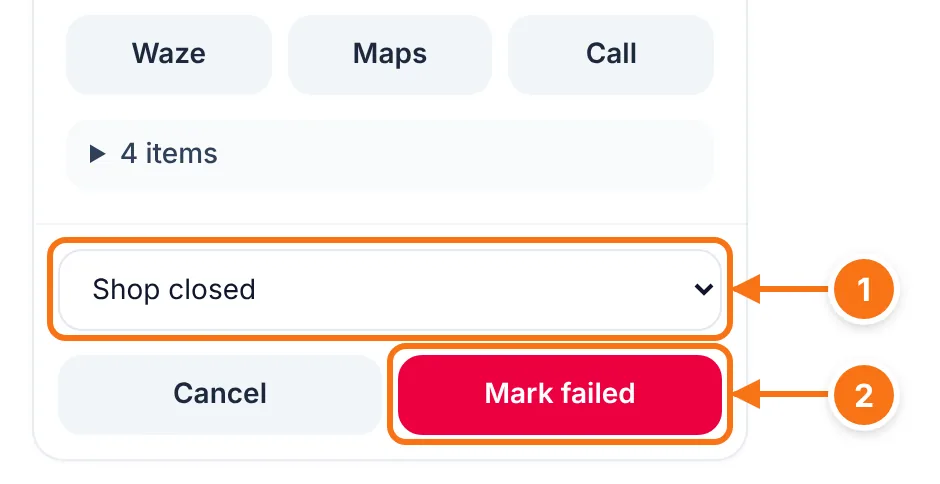
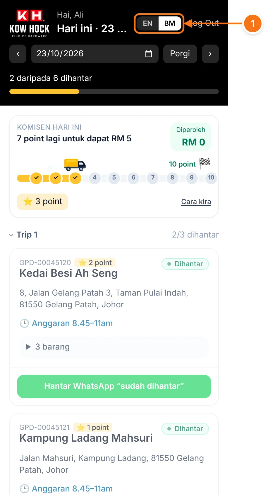

# Driver phone view

What drivers see on their phone: today's DOs, trip by trip, in the order the office planned. See [Signing in](./sign-in) for the PIN keypad and adding the app to the home screen.

## Today's deliveries

- 1 **EN / BM.** Switch between English and Bahasa Melayu. The phone remembers it.
- 2 **Day.** It always opens on today. **‹ ›** go to the day before or after, or pick a date and tap **Go**.
- 3 **Progress** for the day: how many DOs are delivered.
- 4 **Today's commission.** Points earned so far and how many more to the next ringgit. Tap **How it works** for the rules.
- 5 **Trip 1.** DOs are grouped by trip, first trip first.
- 6 **A DO card**: DO number and points, customer, address, estimated time and the office's notes.

- 1 A later trip stays **folded** until the trip before it is finished. Tap it to look inside anyway.

## Start a delivery

- 1 **Estimated time** the office gave the customer.
- 2 **Notes** from the sales order, for example where to unload.
- 3 **Start delivery** when you leave for this customer.

## On the way

- 1 **Waze / Maps** open directions to the address. **Call** phones the customer.
- 2 **Items.** Tap to see what's on the DO.
- 3 **Tell customer I'm on the way** opens WhatsApp with a message already written. Just tap send.
- 4 **Can't deliver** if the delivery can't happen. See [below](#can-t-deliver).
- 5 **Delivered** when the goods are handed over.

## Delivered: take the DO photo

After tapping **Delivered**:

- 1 **Take photo of signed DO / goods.** Opens the camera. The photo is made smaller first to save mobile data.
- 2 **Received by / note** (optional), for example who signed.
- 3 **Confirm.**

- 1 The DO is now **Delivered**.
- 2 **Send "delivered" WhatsApp** opens WhatsApp with a thank-you message to the customer.

The office sees it at the same moment. The card moves to **Delivered** on their Deliveries page without refreshing:

- 1 The DO the driver just delivered, now in the **Delivered** column.

The DO photo is saved with the DO. Admins can see it on the sales order's page.

## Can't deliver

- 1 **Why**: customer not available, shop closed, wrong address, customer rejected goods, vehicle problem, or **Other** (then type what happened).
- 2 **Mark failed.** The office sees the reason and will reschedule it.

## Bahasa Melayu

- 1 Tap **BM** for Bahasa Melayu or **EN** for English. Failure reasons are still saved in English for the office.

