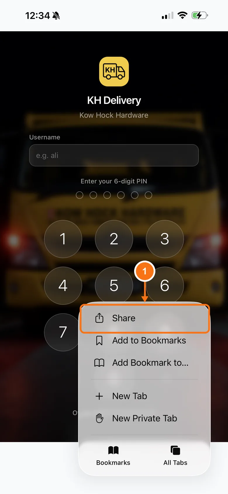
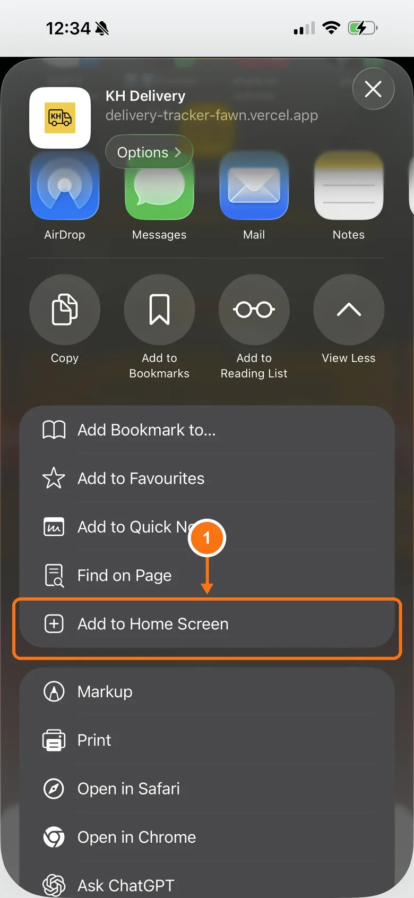
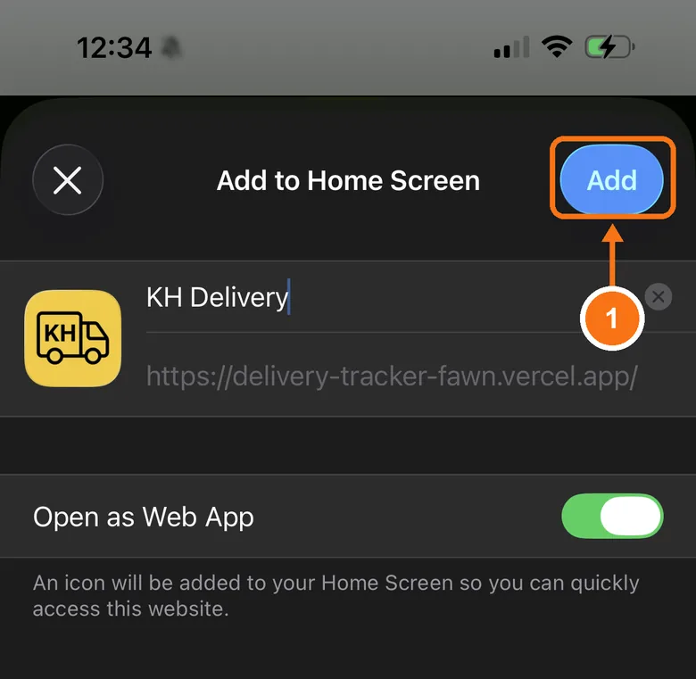
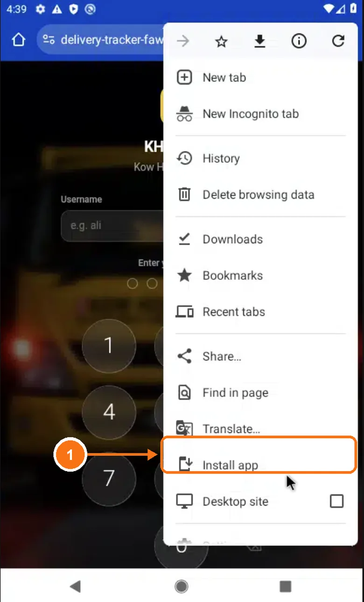
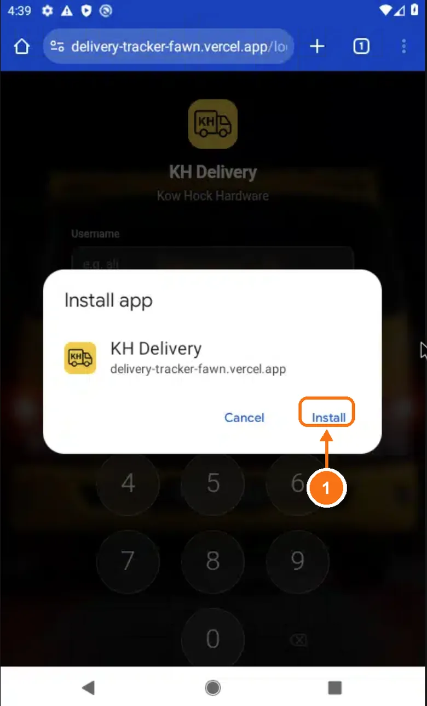
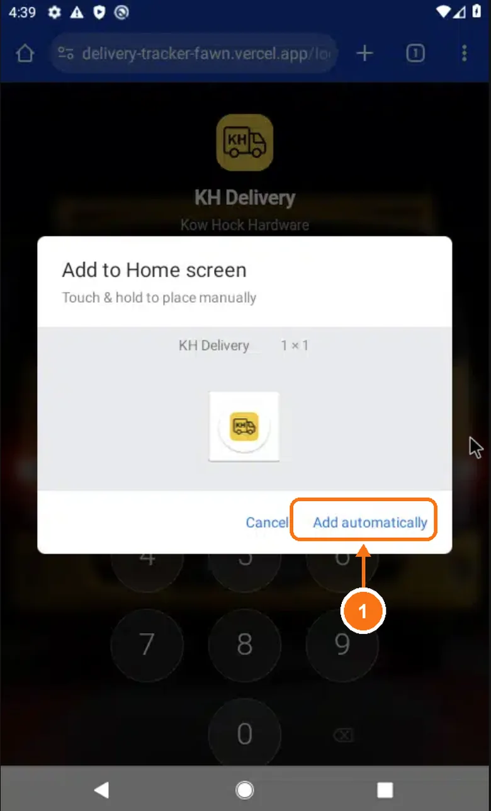

# Add to home screen

Put Delivery Tracker on your phone's home screen so it opens like a normal app, full screen, with one tap. You only do this once.

First open **[delivery-tracker-fawn.vercel.app](https://delivery-tracker-fawn.vercel.app)** on the phone.

## iPhone

Use **Safari** (the blue compass icon).

### 1. Tap ••• then Share

- 1 Tap **•••** at the bottom right, then tap **Share**. On older iPhones, **Share** (the square with an arrow pointing up) is right in the bottom bar.

### 2. Tap Add to Home Screen

- 1 Tap **Add to Home Screen**. If you don't see it, tap **View More** first, then scroll down.

### 3. Tap Add

- 1 Leave the name and **Open as Web App** as they are, and tap **Add** at the top right.

## Android

Use **Chrome**.

### 1. Tap Install app

- 1 Tap **⋮** at the top right of Chrome, then tap **Install app**. On some phones it says **Add to Home screen**.

### 2. Tap Install

- 1 Tap **Install**.

### 3. Tap Add automatically

- 1 Tap **Add automatically**. The icon goes on your home screen by itself. Some phones skip this step.

## Done

Go to your home screen and tap the **KH Delivery** icon. You sign in the first time, then it remembers you. See [Signing in](./sign-in).
