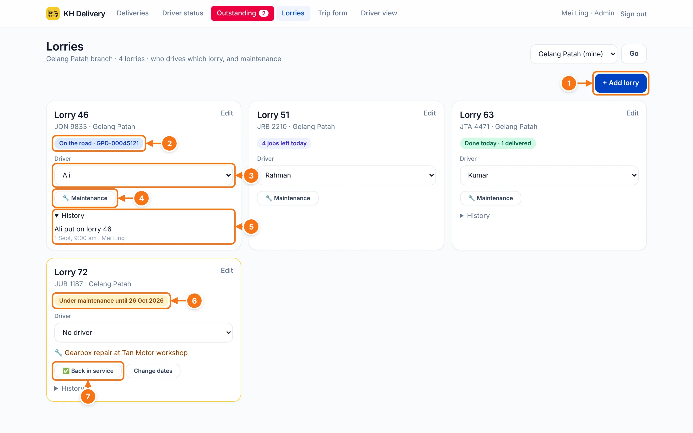
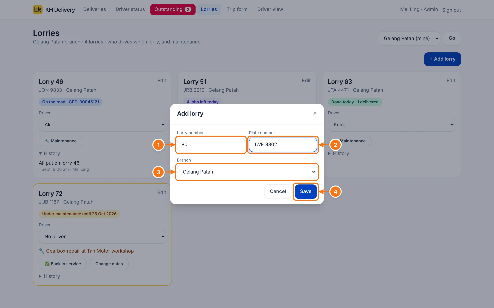
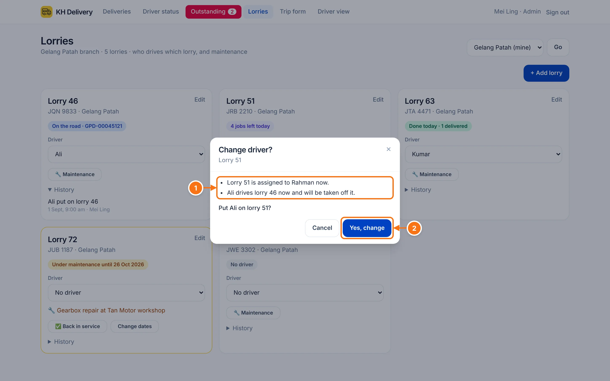
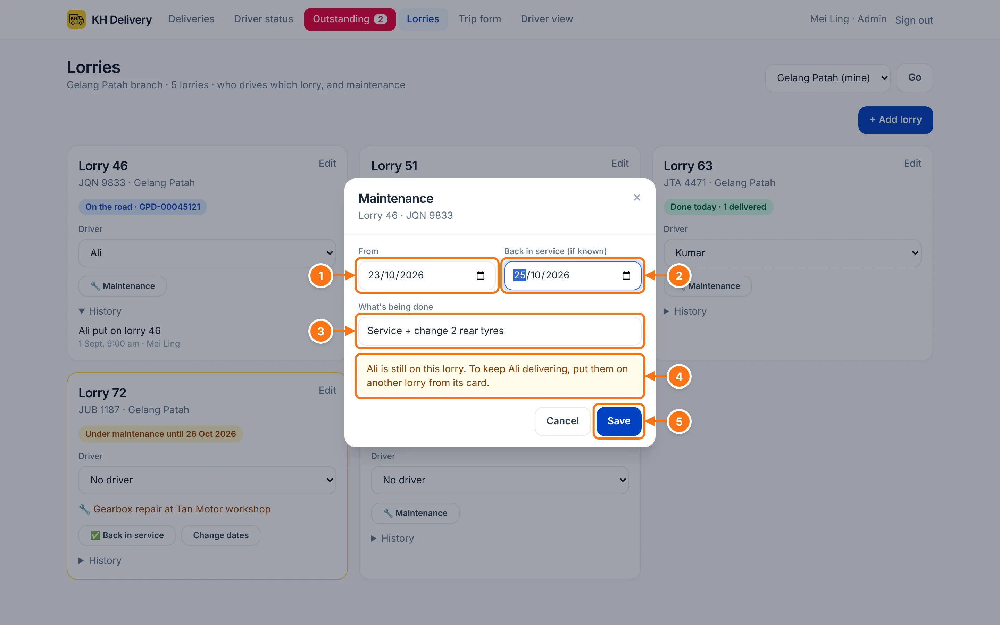

# Lorries

Which driver is on which lorry, what each lorry is doing today, and when it's in for maintenance. The lorry number then shows next to the driver's name everywhere in the app and on the trip form.

## The page at a glance

- 1 **+ Add lorry.** Add a lorry to your branch.
- 2 **What it's doing today:** On the road (with the DO), jobs left today, done today, available, no driver, or under maintenance.
- 3 **Driver.** Pick who drives this lorry. Each lorry has one driver, and each driver one lorry.
- 4 **🔧 Maintenance.** Book the lorry in for maintenance.
- 5 **History.** Driver changes and maintenance, with who did it and when.
- 6 A lorry **under maintenance** has a yellow border and shows until when.
- 7 **✅ Back in service** when it's ready again.

## Add a lorry

- 1 **Lorry number**, the number painted on the lorry (for example 46).
- 2 **Plate number**, for example JQN 9833.
- 3 **Branch** it belongs to.
- 4 **Save.** Then pick its driver on the card.

Use **Edit** on a card to change the number, plate or branch.

## Change a lorry's driver

Pick a different name in the card's **Driver** box. If that changes something else, the app asks first.

- 1 What will happen, for example the lorry's current driver comes off it, or the new driver leaves their old lorry.
- 2 **Yes, change** to go ahead, or **Cancel** to keep things as they are.

## Maintenance

Tap **🔧 Maintenance** on the lorry's card.

- 1 **From.** The day it goes in (can be a future date to book ahead).
- 2 **Back in service**, if you know it. Leave empty if not.
- 3 **What's being done**, for example "Service + tyres". This shows on the card.
- 4 If a driver is still on this lorry, the form reminds you. To keep them delivering, put them on another lorry from that lorry's card.
- 5 **Save.**

When it's fixed, tap **✅ Back in service** on the card. Use **Change dates** if the repair takes longer.
