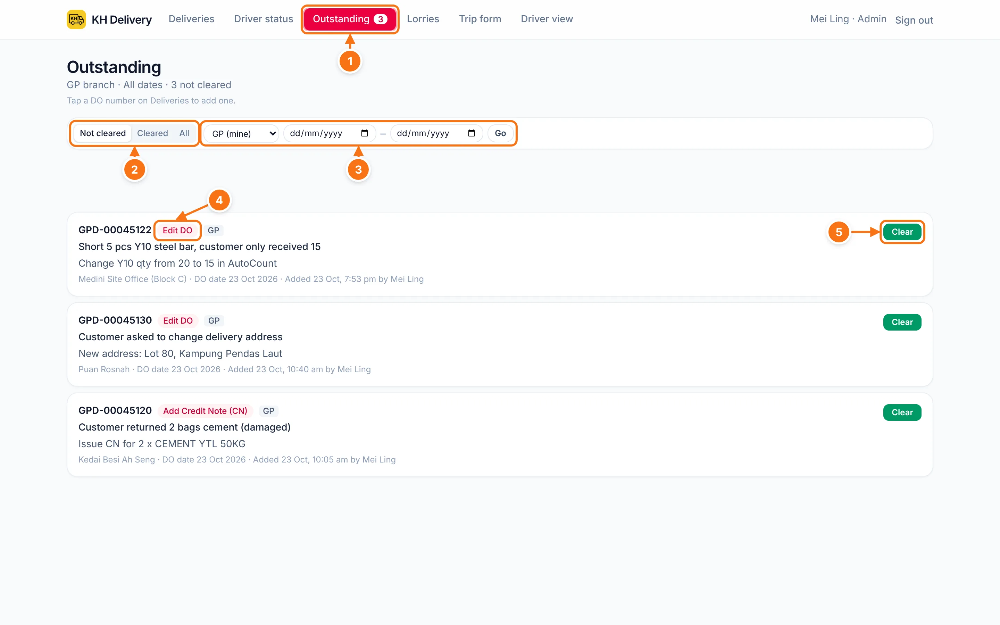
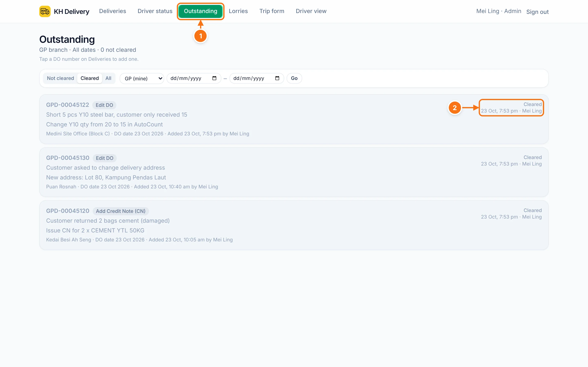

# Outstanding

Every DO that still needs fixing in AutoCount, in one list. Remarks are added from the DO number on [Deliveries](./deliveries#add-a-remark-outstanding).

## The list

- 1 The **Outstanding** tab is **red** with a count while anything isn't cleared. It turns **green** when everything is done.
- 2 **Not cleared / Cleared / All.** It opens on what still needs doing.
- 3 **Branch and dates.** The dates are the day the remark was added. Tap **Go** to filter.
- 4 **What to do** in AutoCount: Add Credit Note (CN), Edit DO, Add Delivery Return (DR), or your own text.
- 5 **Clear.** Tap after you've fixed it in AutoCount.

Each row shows the DO number, the reason, the description, the customer, the DO date, and who added it and when.

## After clearing

- 1 With nothing left, the tab is green.
- 2 The **Cleared** tab shows when each one was cleared and by whom.

::: tip Daily habit
Check the Outstanding tab before going home. If it's red, something still needs fixing in AutoCount.
:::
