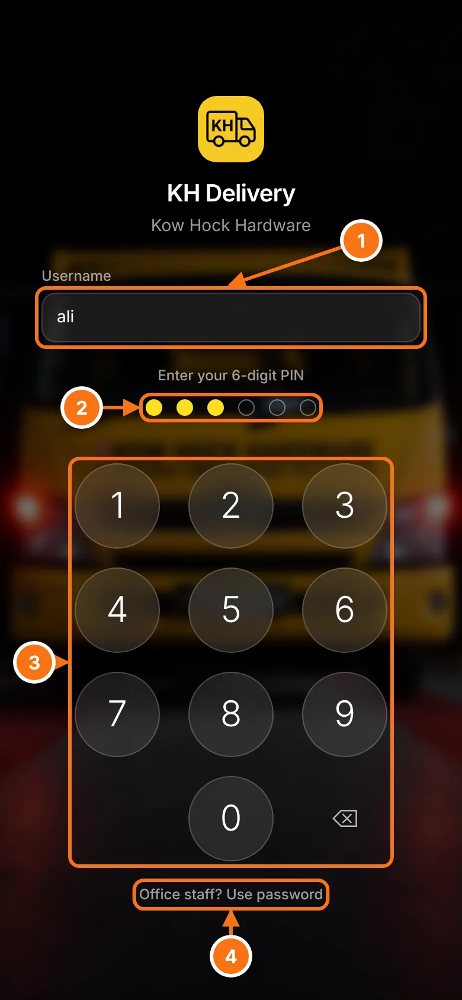

# Signing in

Your username and password (or PIN) are set up by the admin. If you forget them, ask the admin to reset it.

## On a phone (drivers)

- 1 Type your **username**, for example `ali`. The phone remembers it, so next time you only need your PIN.
- 2 The dots fill up as you type your **6-digit PIN**. It signs in by itself after the 6th digit. A wrong PIN shakes the dots and clears them.
- 3 The keypad. **⌫** deletes the last digit.
- 4 Office staff using a phone can tap **Office staff? Use password** to type a normal password instead.

::: tip Make it an app on the phone
Open the link in the browser, then:
- **iPhone (Safari):** tap Share → **Add to Home Screen**
- **Android (Chrome):** tap ⋮ → **Add to Home screen**

It then opens like a normal app from the home screen.
:::

## On a computer (office)

- 1 Your **username** (or full email if you were given one).
- 2 Your **password**, then press Enter or **Sign in**.

Office staff land on [Deliveries](./deliveries). Drivers land on the [driver phone view](./driver).
