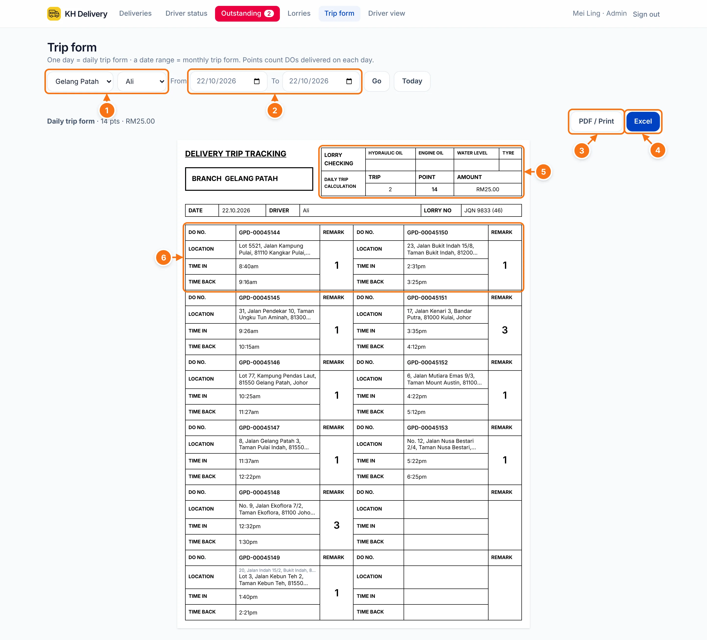
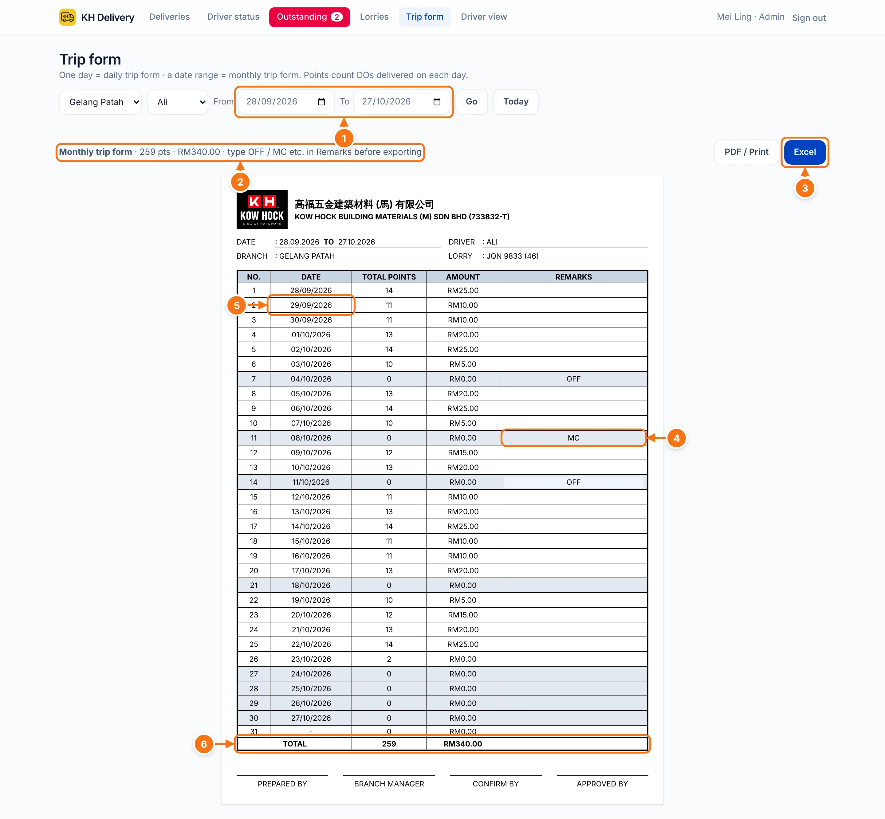

# Trip form

The driver's trip form, filled in from what they actually delivered, in the same layout as our paper form. Pick **one day** for the daily form, or **a date range** for the monthly form.

Points count the DOs delivered on each day (by the time the driver tapped Delivered). See [Points & commission](./points).

## Daily trip form

- 1 **Branch and driver.**
- 2 **From / To.** Pick the same day in both, then tap **Go**. **Today** jumps back to today.
- 3 **PDF / Print.** Opens the print window. Choose **Save as PDF** to get a PDF, or pick a printer.
- 4 **Excel.** Downloads the same form as an Excel file.
- 5 **Lorry checking** boxes (ticked by hand) and the day's **trips, points and amount**.
- 6 One box per DO: **DO no.**, **location**, **time in** (when the driver tapped Start delivery), **time back** (when they tapped Delivered), and the points in the remark box.

::: info
- Points with a **blue** background were keyed in by the office instead of worked out from the distance.
- If the office changed the delivery address, the box shows the AutoCount address on top and the one used below it.
- 12 DOs fit on one page. More DOs go onto more pages.
:::

## Monthly trip form

For example **28 Sep – 27 Oct** for the month's commission.

- 1 **From / To.** Pick the start and end of the period (up to 31 days), then **Go**.
- 2 Total **points** and **amount** for the period.
- 3 **Excel** (or **PDF / Print**) when it's ready.
- 4 **Remarks.** Click the box and type, for example **OFF** or **MC**. It changes to capital letters by itself.
- 5 Click a **date** to open that day's daily form.
- 6 **Total** for the period. Signature lines are at the bottom.

Days with no deliveries are shaded grey.

::: warning Export before leaving the page
Remarks you type are **not saved**. They only go into the PDF or Excel you make. Type them, then print or export straight away.
:::
